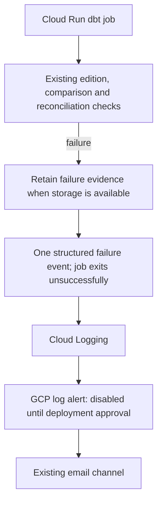

# A failed dbt job should be visible

This addition is prepared and tested offline. It is not deployed, and no pipeline
alert email has been demonstrated yet. The existing API availability alert is
separate and remains unchanged.

The wrapper catches configuration, execution and evidence-upload exceptions. It
writes one JSON event to stdout and re-raises the original exception. It does not
change the runner's stop-on-failure behavior or add a second notification sender
in Airflow. A failed edition build still prevents the comparison build.

The event contains the execution ID, edition dataset (when configuration has been
validated), broad stage and exception type. It omits input rows, raw configuration
and exception messages. Detailed reasons stay in the existing restricted logs and
retained evidence. Malformed configuration may have no edition ID. A storage
failure may prevent evidence publication; use execution logs in that case.

Cloud Run collects stdout; no Logging SDK, extra runtime grant or counter is needed.
The policy matches only this versioned event from `runwx-dbt` in `europe-west1`.
It reuses the existing email channel and defaults to disabled. No per-execution
metric or alert labels are created. Notifications are limited to once per 15
minutes; multiple failures can share an incident, so inspect the entire window.
An incident auto-closes after a day without matching events; that is not proof
that a later run succeeded.

## Boundaries

- Both the dbt Cloud Run job and its current Airflow caller have retries disabled.
  Revisit alert ownership before adding retries; this event marks a failed job
  invocation, not an automatically deduplicated end-to-end workflow failure.
- Export, loading, Airflow-only failures and local preparation are not covered.
- Process termination, out-of-memory kills and failures before Python starts may
  produce no application event. This is not complete job availability monitoring.
- Expected exclusions do not raise this event. Mark deliberate exercises with
  `RUNWX_EXECUTION_PURPOSE=exercise`; the operational policy excludes them.
- There is no missing-run alert: refreshes are manual, and quiet periods are normal.
- Earlier BigQuery views can remain after a later failure. Never interpret a
  failure notification as a rollback or retry blindly.

## What to do when notified

1. Open the job logs from the incident. Find the execution ID and failure stage.
2. Inspect the execution's detailed logs and its immutable `dbt-runs` evidence,
   if published. See [the evidence contract](dbt-models.md).
3. Correct the input/configuration or diagnose the failed build, reconciliation
   or upload. Check what already completed before approving a rerun.
4. Confirm the later execution reconciles. Incident closure alone is insufficient.

## Verification and next deployment gate

Offline tests cover a successful run without a failure event, runner rejection
with retained evidence, malformed configuration before any runner/upload,
upload failure, exercise marking and preservation of the original error when
logging fails. Existing stage-runner tests check downstream work stops. Mocked
Terraform tests check the scope, disabled default and notification limit.
These tests do not demonstrate GCP log ingestion or email delivery.

After PR/CI and approval, prepare an immutable dbt image and saved Terraform
plans. Review the image-only job update and separate monitoring policy addition
before apply. Keep retries at zero. No API image change is needed for this slice.

A separately approved live check should run one deliberately invalid configuration
that fails before any warehouse work. Mark it as an exercise and temporarily use
a narrowly scoped exercise policy, then remove that policy. Check receipt of the
email, execution logs and absence of downstream work. Record actual results before
adding this to the website as a demonstrated capability. Do not infer an email
success from an offline test or enable operational alerts for unmarked exercises.

## Documentation checked

Context7 was used to check the installed Google provider's
[log-match alert contract](https://github.com/hashicorp/terraform-provider-google/blob/v7.46.1/website/docs/r/monitoring_alert_policy.html.markdown)
(required notification rate limit and extracted-label grouping), and Google's
[structured logging guidance](https://cloud.google.com/logging/docs/structured-logging)
and [stdout versus client libraries](https://cloud.google.com/logging/docs/agent-or-library).
