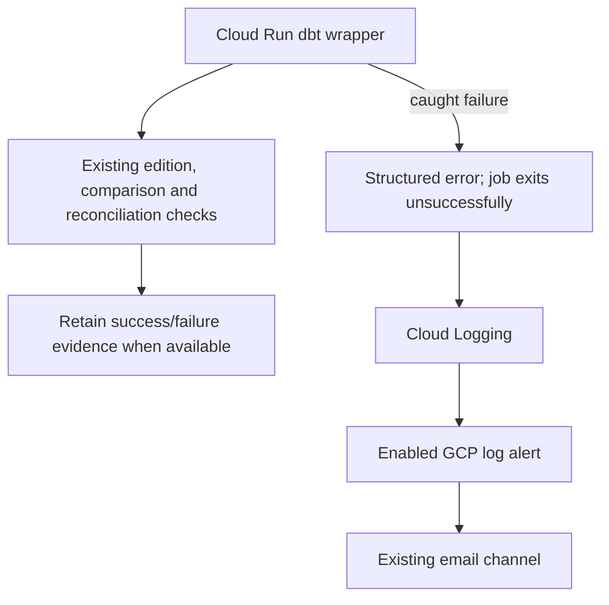

# A failed dbt job should be visible

The Cloud Run dbt failure alert is enabled. A marked real-job test on 26 October
2026 produced an incident and an email confirmed received. The API availability
alert is separate: it checks whether the site responds.

The wrapper catches configuration, execution and evidence-upload exceptions. It
writes one JSON event to stdout and re-raises the original exception. It does not
change the runner's stop-on-failure behavior or add a second notification sender
in Airflow. A failed edition build still prevents the comparison build.

The event contains the execution ID, edition dataset (when configuration has been
validated), broad stage and exception type. It omits input rows, raw configuration
and exception messages. Detailed reasons stay in the existing restricted logs and
retained evidence. Malformed configuration may have no edition ID. A storage
failure may prevent evidence publication; use execution logs in that case.

Cloud Run collects stdout; no Logging SDK, extra runtime grant or counter is needed.
The policy matches only this versioned event from `runwx-dbt` in `europe-west1`.
It reuses the existing email channel. Terraform defaults new setups to disabled;
the deployed configuration explicitly enables it. No per-execution
metric or alert labels are created. Notifications are limited to once per 15
minutes; multiple failures can share an incident, so inspect the entire window.
An incident auto-closes after a day without matching events; that is not proof
that a later run succeeded.

## Boundaries

- Both the dbt Cloud Run job and its current Airflow caller have retries disabled.
  Revisit alert ownership before adding retries; this event marks a failed job
  invocation, not an automatically deduplicated end-to-end workflow failure.
- Export, loading, Airflow-only failures and local preparation are not covered.
- Process termination, out-of-memory kills and failures before Python starts may
  produce no application event. This is not complete job availability monitoring.
- Expected exclusions do not raise this event. Mark deliberate exercises with
  `RUNWX_EXECUTION_PURPOSE=exercise`; the operational policy excludes them.
- There is no missing-run alert: refreshes are manual, and quiet periods are normal.
- Earlier BigQuery views can remain after a later failure. Never interpret a
  failure notification as a rollback or retry blindly.

## What to do when notified

1. Open the job logs from the incident. Find the execution ID and failure stage.
2. Inspect the execution's detailed logs and its immutable `dbt-runs` evidence,
   if published. See [the evidence contract](dbt-models.md).
3. Correct the input/configuration or diagnose the failed build, reconciliation
   or upload. Check what already completed before approving a rerun.
4. Confirm the later execution reconciles. Incident closure alone is insufficient.

## Verified cloud test

On 26 October 2026, execution `runwx-dbt-nlcjr` ran once with deliberately invalid
JSON and an exercise marker. One task failed with exit code 1, with zero retries.
It stopped before client creation, dbt builds or BigQuery work. Cloud Logging
captured the configuration error; Monitoring opened an incident and the email
arrived. The recipient confirmed receipt.

The temporary test policy used the operational filter with the purpose changed
to `exercise`. Its incident was retained before the policy was deleted. The stored
job was unchanged. The operational alert was then enabled through a saved plan;
readback and the full monitoring follow-up plan confirmed the setting. See the
[compact test record](evidence/dbt-failure-alert-validation.json).

An earlier attempt did not verify notification delivery. An isolated routing test
and the later dbt test passed; the original cause remains unconfirmed. This is
not a claim that every failure type was exercised live.

Offline tests additionally cover runner rejection with retained evidence,
malformed configuration before any runner/upload, upload failure, exercise marking
and preservation of the original error when logging fails. Existing runner tests
check that failed stages block later work. Mocked Terraform tests check the
policy's scope, disabled default and notification limit.

For a new setup, deploy the immutable image and review the disabled policy first.
Use a separately approved, marked exercise to verify the event, incident and email
before enabling operational alerts. Retain incident evidence before cleanup and
follow log-search continuation tokens. Never infer delivery from a job failure
alone or retry a submission with an unknown outcome.

## Documentation checked

Context7 was used to check the installed Google provider's
[log-match alert contract](https://github.com/hashicorp/terraform-provider-google/blob/v7.46.1/website/docs/r/monitoring_alert_policy.html.markdown)
(required notification rate limit and extracted-label grouping), and Google's
[structured logging guidance](https://cloud.google.com/logging/docs/structured-logging)
and [stdout versus client libraries](https://cloud.google.com/logging/docs/agent-or-library).
