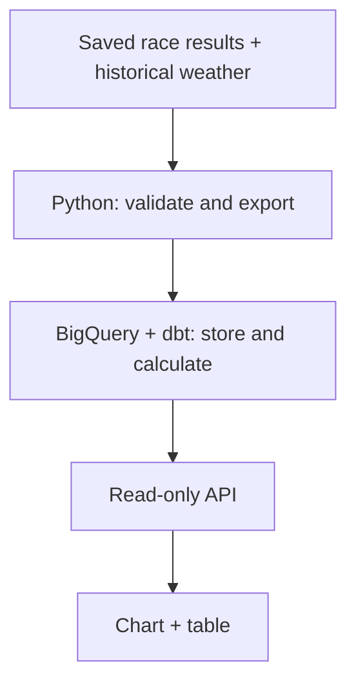

# runwx in two minutes

A simple chart sits on top of a data pipeline: saved race results and historical
weather become checked, repeatable comparisons.

## 1. Start with the result

[Open Battersea Park 10K](https://runwx-api-f6n35ol7sa-ew.a.run.app/?course=battersea-park-10k&pace=median-pace&weather=temperature).
There are **18 race dates and 2,725 finishers**. Follow median pace alongside
temperature, then switch the weather measure to wind. The table gives the numbers
behind the chart.

Different runners enter each race. This is a way to explore historical patterns,
not proof that weather caused a pace change.

## 2. Follow the data

Three choices keep the output explainable:

- **Keep the inputs.** File hashes identify the exact snapshots used. An identical
  rerun verifies existing rows instead of loading duplicates.
- **Calculate in one place.** dbt owns the statistics. The API serves those results
  without recalculating them in Python.
- **Check the answer.** Independent reconciliation compares warehouse results with
  saved expectations before a run is reported as successful.

The [visual pipeline tour](https://runwx-api-f6n35ol7sa-ew.a.run.app/how-it-works)
follows Folkestone 2019: **459 accepted results and 459 weather matches**.
Separate Cloud Run jobs handle export and dbt. Airflow coordinated a verified
Composer run; that environment was removed, and historical refreshes are manual.

## 3. See what happens when it fails

In a real Composer run, a missing timing setting changed the exported data.
The expected hash check caught it and stopped the pipeline **before BigQuery and
dbt**. After the setting was corrected, the run passed. An identical rerun verified
all 459 existing rows without submitting another load.

That is the engineering behind the chart: catch a mismatch, keep the evidence,
and rerun without duplicating data. It does not provide automatic rollback.

[See the failure and recovery guide](failure-and-recovery.md) for the recorded
cloud runs and offline tests. API availability also has a dashboard and
[tested email alerts](../infra/gcp/monitoring/README.md#verified-alert-test).
